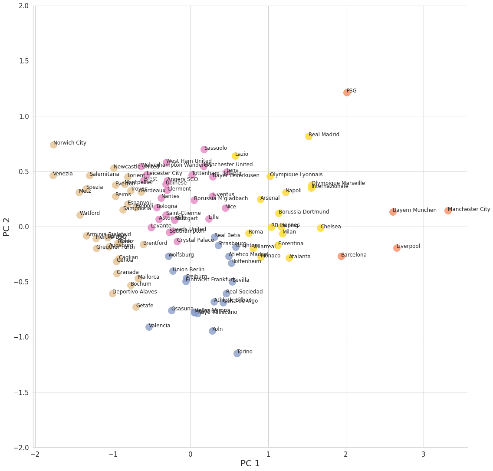

# Modelo de Jogo

Análise das equipes das cinco principais ligas europeias na temporada 2021/22 por estilo de jogo, com métricas coletivas do Wyscout, PCA e K-Means em Python, para ajudar um clube a escolher destinos de empréstimo com modelo de jogo semelhante ao seu. Trabalho final do mestrado em Big Data Aplicado ao Futebol.

> **English:** Analysis of the teams from Europe's top five leagues during the 2021/22 season by playing style, using Wyscout team metrics, PCA and K-Means, to help a club shortlist loan destinations with a similar playing model. Group project; the report is in Portuguese.

Projeto desenvolvido em grupo por Tiago Alves, Vinicius Incrocci e Guilherme Ferreira, como trabalho final do Módulo 12 (Sports Data Campus).

## Resultado

O modelo separou as equipes em cinco grupos, nomeados pela posição no mapa do PCA:

| Cluster | Perfil |
| --- | --- |
| Leste | O mais propositivo e eficiente: pressão alta, recuperações no terço final, posses longas com passes curtos e a melhor produção ofensiva. Inclui equipes como Manchester City, Bayern de Munique, Liverpool, Barcelona e PSG. |
| Sudeste | Jogo de posse e marcação adiantada: recupera no terço final e cede poucas chances, mas sem o predomínio do Leste. |
| Norte | Direto, físico e combativo: muitos duelos aéreos e faltas, ataques pelos lados. |
| Noroeste | Jogo direto com bola longa: posses curtas, muitos duelos aéreos, poucos remates e gols. |
| Sudoeste | O mais passivo: poucas recuperações, PPDA alto, cede campo e posse, baixa produção ofensiva. |

## Objetivos

- Analisar indicadores de desempenho coletivo das equipes das principais ligas nacionais europeias.
- Identificar padrões e semelhanças entre os estilos de jogo das equipes.
- Aplicar técnicas de redução de dimensionalidade e agrupamento para explorar os dados.
- Utilizar visualizações para facilitar a interpretação dos resultados.

## Tecnologias utilizadas

- **Python:** processamento e análise dos dados.
- **Pandas e NumPy:** manipulação e preparação dos dados.
- **Scikit-learn:** normalização, PCA e aplicação do algoritmo KMeans.
- **Matplotlib e Seaborn:** visualização e análise dos dados.
- **Plotly:** criação de visualizações interativas em 2D e 3D.

## Metodologia

O projeto envolve a preparação e o enriquecimento dos dados (percentuais e razões calculados a partir das métricas originais), a agregação por equipe (média das partidas), a normalização de 37 indicadores com MinMaxScaler (20 do momento com bola, 16 sem bola e 1 de ambos) e a aplicação de PCA (*Principal Component Analysis*) para reduzir a dimensionalidade. Em seguida, o algoritmo KMeans agrupa as equipes sobre as duas primeiras componentes, com o número de clusters definido pelo método do cotovelo.

Os grupos foram interpretados comparando a média de cada cluster em cada indicador, e o resultado está detalhado no relatório.

## Dados

Os dados de desempenho coletivo (3.590 linhas de partidas e 293 colunas) vêm do Wyscout, uma plataforma paga, e **não estão incluídos neste repositório**. O notebook lê dois arquivos (`Top5.csv` e `Teams_Top5.xlsx`) que precisam ser fornecidos por quem quiser reproduzir a análise.

## Arquivos do projeto

- `Codigo_Modulo12_Modelo_de_Jogo_Grupo1_MBDAF.ipynb`: notebook Jupyter com as etapas de preparação, análise, modelagem e visualização dos dados.
- `Relatorio_Modulo12_Modelo_de_Jogo_Grupo1_MBDAF.pdf`: relatório com a apresentação do projeto e seus resultados.
- `images/`: figura usada neste README.
